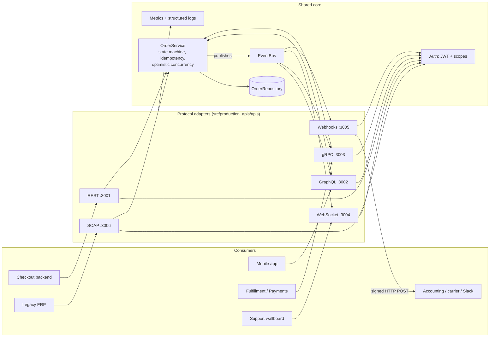
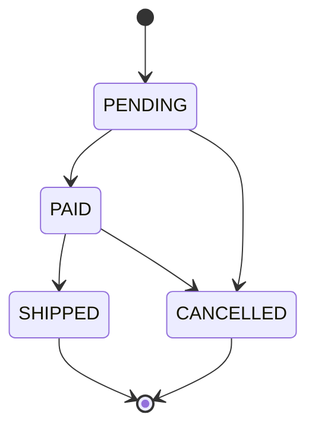
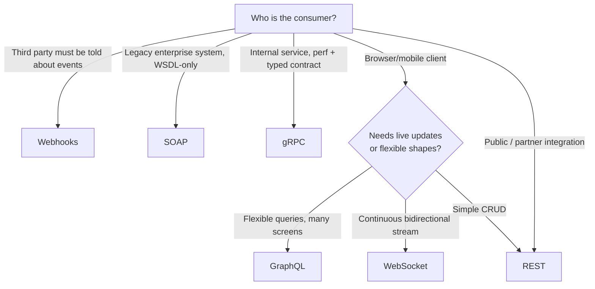

# Design

Companion to [scenarios.md](scenarios.md). The scenarios say *who needs what*; this document
says *how the system is shaped to deliver it* and *why*.

## 1. Goals and non-goals

**Goals**

- Show six API styles, each chosen for a real consumer need (see scenarios), not for variety.
- Show the production concerns that distinguish a demo from a service: authentication,
  authorization, validation, idempotency, error contracts, rate limiting, observability,
  resilience, secure defaults, tests, containerisation and CI.
- Keep one business domain so the *only* thing that differs between APIs is the protocol.

**Non-goals** (deliberately out of scope, each documented as a seam)

| Not included | Why | Seam to add it |
|---|---|---|
| Durable database | Would dominate the repo and hide the API lessons | `OrderRepository` protocol; swap in Postgres |
| Message broker | Same | `EventBus` is the single fan-out point; swap for Redis/NATS/Kafka |
| Identity provider | Tokens are minted locally for demos | `Authenticator.verify` is the only place tokens are validated (swap for JWKS/OIDC) |
| TLS termination | Belongs to ingress / service mesh | Documented per API in `docs/operations.md` |

## 2. Architecture

One domain core, six thin protocol adapters. Adapters translate wire format ⇄ domain calls
and nothing else; **no business rule lives in an adapter**.



### Layers and dependency rule

```
apis/*  ──►  domain/  ──►  core/
(protocol)   (business)    (cross-cutting)
```

Dependencies point inward only. `domain/` knows nothing about HTTP, protobuf or XML.
`core/` (config, auth, errors, logging, metrics, HTTP middleware) knows nothing about orders.
This is what lets six protocols share one implementation of the rules.

### Request/event flow

*Command path* (request/response APIs): adapter → authenticate → authorize scope → validate →
`OrderService` → repository → publish event → serialize response.

*Event path* (streaming + push APIs): `OrderService` publishes to `EventBus` → each
subscriber filters and forwards in its own protocol:

| Subscriber | Delivery | Backpressure policy |
|---|---|---|
| GraphQL subscription | async generator over graphql-transport-ws | bounded queue (1000) |
| gRPC `WatchOrders` | async generator on HTTP/2 stream | HTTP/2 flow control + bounded queue |
| WebSocket | per-connection outbound queue | queue of 100; overflow ⇒ close `1013` |
| Webhook dispatcher | async task per delivery | bounded retries ⇒ dead-letter |

Subscribers are isolated: an exception in one never reaches the publisher or other
subscribers.

## 3. Domain model



`Order { id, customerId, currency, items[], totalCents, status, version, createdAt, updatedAt }`

- **Money is integer minor units** (`totalCents`), never floats.
- **`version`** increments on every change. It is the optimistic-concurrency token
  (`If-Match` in REST, `expectedVersion` in GraphQL/gRPC).
- **Idempotency**: `create` accepts a client key. Same key + same body ⇒ same order;
  same key + different body ⇒ `CONFLICT`. The key is fingerprinted with SHA-256 of the
  normalised body.
- **Events**: `order.created`, `order.status_changed`. Event ids are UUIDs and double as the
  webhook id so receivers can de-duplicate.

## 4. Cross-cutting design decisions

### 4.1 One error taxonomy, many wire formats

`AppError(code)` is the only error business code raises. Each adapter owns a mapping table:

| `ErrorCode` | HTTP | gRPC | GraphQL `extensions.code` | SOAP faultcode | WebSocket |
|---|---|---|---|---|---|
| VALIDATION | 400 | INVALID_ARGUMENT | VALIDATION | soap:Client | `error` msg |
| UNAUTHENTICATED | 401 | UNAUTHENTICATED | UNAUTHENTICATED | soap:Client | HTTP 401 at upgrade |
| FORBIDDEN | 403 | PERMISSION_DENIED | FORBIDDEN | soap:Client | HTTP 403 at upgrade |
| NOT_FOUND | 404 | NOT_FOUND | NOT_FOUND | soap:Client | `error` msg |
| CONFLICT | 409 | ALREADY_EXISTS | CONFLICT | soap:Client | `error` msg |
| PRECONDITION_FAILED | 412 | FAILED_PRECONDITION | PRECONDITION_FAILED | soap:Client | `error` msg |
| RATE_LIMITED | 429 | RESOURCE_EXHAUSTED | RATE_LIMITED | soap:Server | close `1008` |
| INTERNAL | 500 | INTERNAL | INTERNAL (masked) | soap:Server | close `1011` |

Unexpected exceptions are **never** serialised: they are logged server-side and replaced by a
generic `INTERNAL` error so stack traces and internals do not leak.

### 4.2 Security model

| Threat | Control | Where |
|---|---|---|
| Forged / expired tokens | HS256 pinned (no `alg` downgrade), `iss`/`aud`/`exp` required, 5 s leeway | `core/auth.py` |
| Privilege escalation | Scope check per operation in *every* adapter; deny-by-default for unknown gRPC methods | adapters |
| Information leakage | Vague auth errors, masked internal errors, no stack traces, no secrets in logs (redaction) | `core/errors.py`, `core/logging.py` |
| Abuse / DoS | Rate limiting, body-size caps, GraphQL depth limit, WS frame size + message rate + connection cap, gRPC max message size + concurrent RPC cap | per adapter |
| Injection into XML | `defusedxml` (no external entities / entity expansion), size limits | `apis/soap` |
| SSRF via webhooks | Scheme/credential checks, DNS resolve + private/link-local/loopback block, re-check at delivery, redirects disabled | `apis/webhooks/ssrf.py` |
| Webhook forgery & replay | HMAC-SHA256 over `id.timestamp.body`, constant-time compare, 5 min tolerance, secret rotation | `apis/webhooks/signing.py` |
| Cross-site WebSocket hijacking | Origin allow-list; token via subprotocol, not URL (URLs get logged) | `apis/websocket` |
| Secrets in config | Validated at startup; production refuses to start without `JWT_SECRET` | `core/config.py` |
| Clickjacking / sniffing / caching | Security headers on HTTP responses | `core/http.py` |

### 4.3 Observability

- **Logs**: structured JSON (structlog), request-id on every HTTP request (accepted from
  `X-Request-Id` or generated) and echoed in every error body, so a customer can quote it.
- **Metrics** (`/metrics`, Prometheus): `api_requests_total{api,operation,outcome}`,
  `api_request_duration_seconds{api,operation}`, `api_active_connections{api}`,
  `webhook_deliveries_total{outcome}`. The same `observe()` wrapper instruments all APIs,
  so dashboards and alerts are uniform across protocols.
- **Health**: `/healthz` (liveness), `/readyz` (readiness: dependency ping),
  `grpc.health.v1` for gRPC.

### 4.4 Resilience

- Every outbound call has a timeout; every queue/buffer is bounded; every long-lived
  connection has a heartbeat or deadline.
- Graceful shutdown: stop accepting → flip readiness/`NOT_SERVING` → drain in-flight work
  (bounded grace) → close. WebSockets receive `1001 Going Away`.
- Webhooks retry transient failures (network, 5xx, 408/425/429) with exponential backoff and
  jitter, never retry permanent 4xx, and dead-letter after the attempt budget.

### 4.5 Evolution & compatibility

| API | Strategy |
|---|---|
| REST | Version in path (`/v1`); additive changes only within a version |
| GraphQL | Single evolving schema; `@deprecated` before removal; never reuse a field name with new meaning |
| gRPC | Additive-only protobuf; reserve removed numbers; package versioned `orders.v1` |
| WebSocket | `type`-discriminated messages; unknown types answered with `error`, unknown fields ignored |
| Webhooks | Versioned signature scheme (`v1=`); event payload additive; new event types opt-in per endpoint |
| SOAP | WSDL + namespace versioning; published WSDL is the contract |

## 5. Choosing an API style (decision guide)



| | REST | GraphQL | gRPC | WebSocket | Webhooks | SOAP |
|---|---|---|---|---|---|---|
| Direction | req/resp | req/resp (+sub) | req/resp + streams | full-duplex | server→client push | req/resp |
| Contract | OpenAPI | SDL schema | protobuf | message protocol (documented) | event schema + signature | WSDL/XSD |
| Payload | JSON | JSON | binary | JSON frames | JSON | XML |
| Caching | HTTP-native (ETag) | hard (POST) | none | n/a | n/a | none |
| Browser-native | yes | yes | needs gRPC-web | yes | n/a | clumsy |
| Strengths | ubiquity, caching, tooling | no over/under-fetch | speed, codegen, streaming | live, low latency | decoupled notification | enterprise tooling |
| Costs | over/under-fetching | query-cost control, caching | HTTP/2 + tooling needed | stateful scaling, reconnect logic | delivery reliability is *your* problem | verbose, heavy |

## 6. Repository layout

```
docs/                       scenarios.md, design.md, operations.md
proto/orders/v1/            gRPC contract (source of truth)
wsdl/                       SOAP contract (source of truth)
src/production_apis/
  core/                     config, auth, errors, logging, metrics, HTTP middleware
  domain/                   models, state machine, service, repository, event bus
  apis/{rest,graphql,grpc_api,websocket,webhooks,soap}/
  gen/                      generated protobuf stubs (scripts/gen_proto.sh)
  context.py  main.py       dependency container, process entry point
tests/                      one acceptance file per API, tagged with scenario IDs
scripts/                    token minting, demo journey (J1), proto generation
```

## 7. Testing strategy

- **Acceptance tests per API**, named and tagged by scenario ID
  (`@pytest.mark.scenario("S1.2")`), so every Given/When/Then maps to an executable test.
- **Domain unit tests** for the state machine, idempotency, pagination and concurrency, so
  adapters only need to prove translation, auth and protocol behaviour.
- Tests run real protocol stacks where it matters (real gRPC server, real WebSocket
  connections, real HTTP receiver for webhooks, Zeep as an independent SOAP client).
- **Journey test (J1)** exercises all six APIs against one order.
- CI: lint (ruff), type-check (mypy --strict), tests, container build.

## 7.1 Known limitations (honest list)

- State is in-memory: a restart loses orders, and multi-instance deployment would split state
  and rate-limit counters. The repository, event bus and rate limiter are the three seams to
  externalise (Postgres, Redis/NATS, Redis).
- Webhook delivery queue is in-process; production needs a transactional outbox so deliveries
  survive restarts.
- SSRF re-resolution before delivery narrows but does not eliminate DNS-rebinding races;
  production should add an egress proxy.
- JWTs are HS256 with a shared secret for simplicity; production should use asymmetric keys
  via an identity provider (JWKS).
